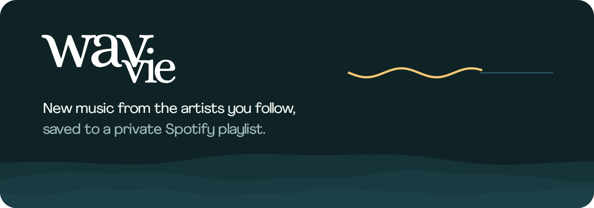
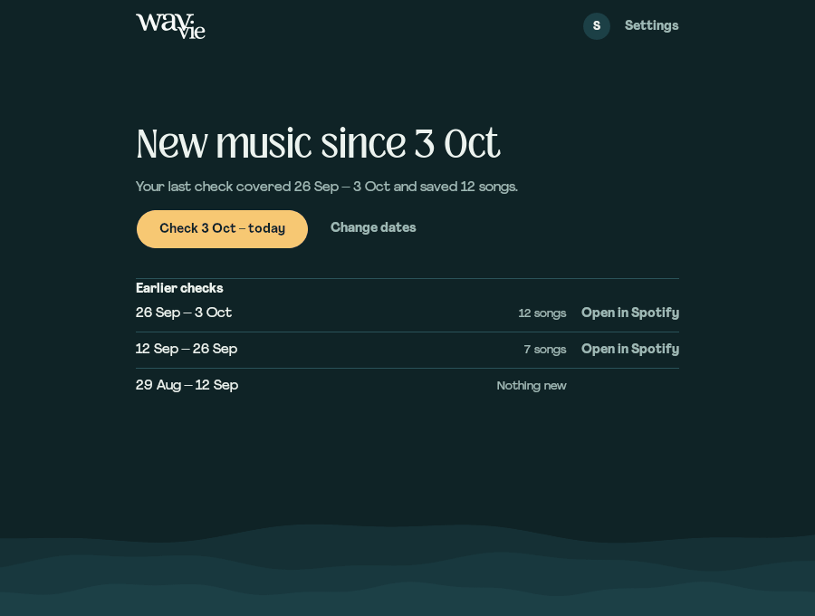
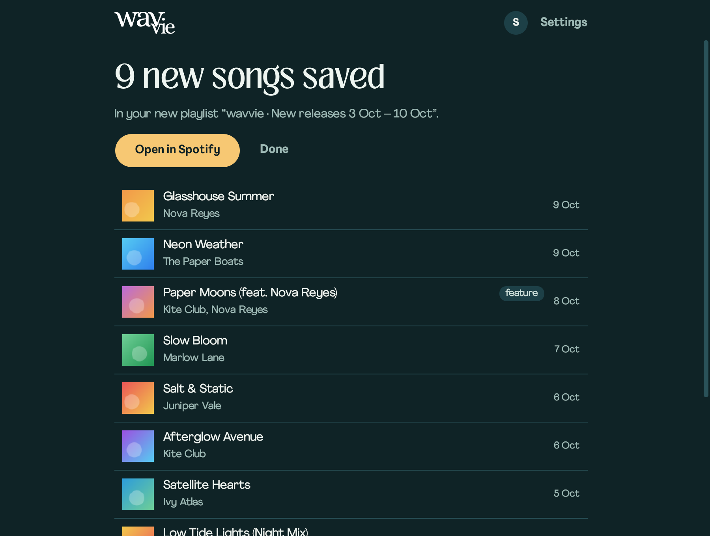
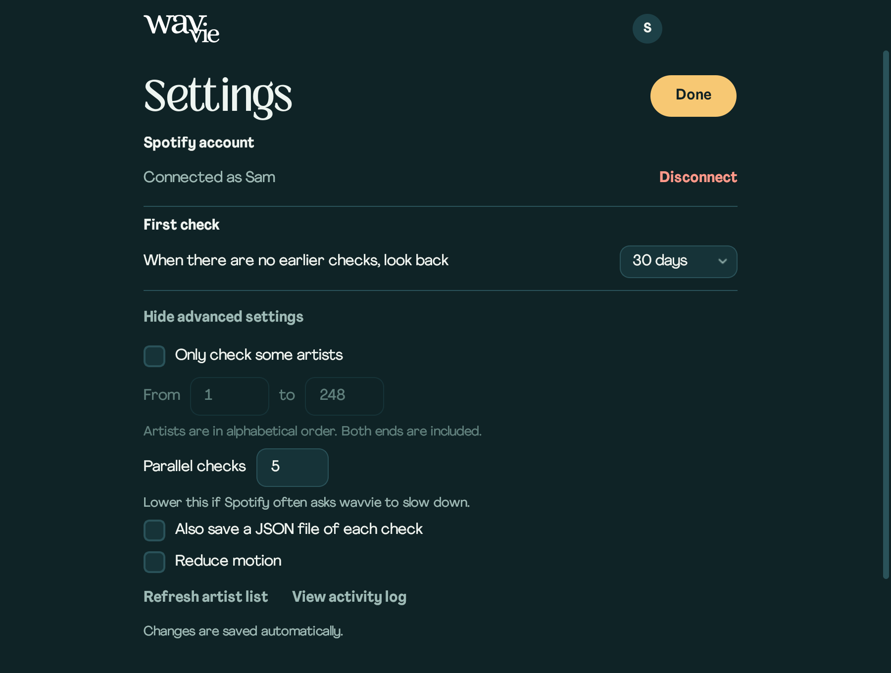
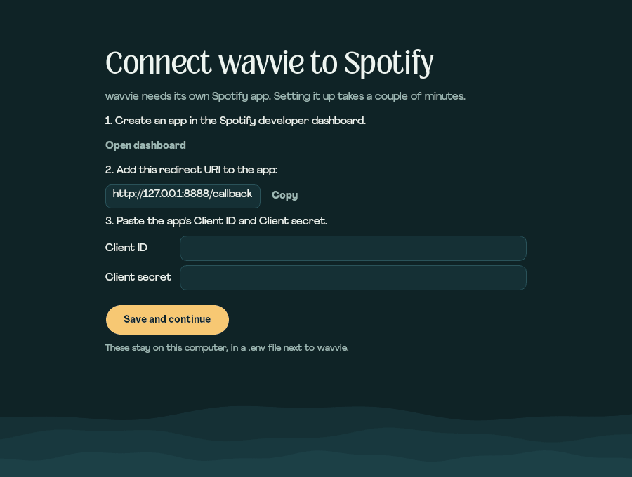

<p align="center">
  
</p>

<p align="center">
  <a href="https://github.com/astytimestwo/wavvie-spotify-engine/releases/latest"></a>
  
  
  
  <a href="LICENSE"></a>
</p>

**wavvie checks every artist you follow on Spotify for new releases and saves the songs to a private playlist.** No algorithm picks for you: one button looks at everything released since your last check, and wavvie remembers where it left off.

<p align="center">
  
</p>

## How it works

1. **Connect once.** The first run walks you through creating your own Spotify app, then writes the `.env` file for you.
2. **Press Check.** wavvie goes through every artist you follow, looking for albums, singles and EPs released since your last check, plus songs they appear on as a guest.
3. **Get a playlist.** New songs go straight into a private playlist named after the dates, like *wavvie · New releases 3 Oct – 10 Oct*.
4. **Come back whenever.** The next check starts where the last one ended. It skips songs it already saved, and if a check couldn't finish, it covers those days again.

## What it finds

- **Releases and features.** Albums, singles and EPs, plus tracks where a followed artist is credited as a guest (feat., with, remix).
- **No filler.** Greatest-hits and best-of collections, workout mixes and chart compilations are skipped, and so are credits where the artist isn't actually on the track.
- **One copy of each song.** When a song is on both a single and an album, wavvie keeps one version.

## The desktop app

<table>
  <tr>
    <td></td>
    <td></td>
  </tr>
</table>

- **One button.** A wave fills while every artist is checked. Stop ends a check without saving anything.
- **Earlier checks.** Your recent checks are listed, each linking to its playlist.
- **Change dates.** Pick a different start for a single check.
- **Settings.** Your account and how far the first check looks back (7, 30, 90 or 180 days). Advanced options cover checking only some artists, parallel checks, a JSON copy of each check, reduced motion, refreshing your artist list and the activity log.
- **Keyboard friendly.** Tab moves between controls. Ctrl+, opens Settings, Esc closes it and Ctrl+L shows the activity log.

## Get started

### 1. Create a Spotify app

1. Open the [Spotify Developer Dashboard](https://developer.spotify.com/dashboard) and create an app.
2. Add this redirect URI to it: `http://127.0.0.1:8888/callback`
3. Keep its Client ID and Client secret handy.

New Spotify apps run in Development Mode: the app's owner needs Spotify Premium, and at most five people can use it.

### 2. Download wavvie

| Platform | Download |
| --- | --- |
| Windows | [wavvie-windows-x64.exe](https://github.com/astytimestwo/wavvie-spotify-engine/releases/latest/download/wavvie-windows-x64.exe) |
| Linux (x86-64) | [wavvie-linux-x86_64.tar.gz](https://github.com/astytimestwo/wavvie-spotify-engine/releases/latest/download/wavvie-linux-x86_64.tar.gz) |

These links always fetch the latest version; older ones are on the [releases page](https://github.com/astytimestwo/wavvie-spotify-engine/releases).

- **Windows:** run the `.exe`. It isn't code-signed, so Windows may say it's from an unknown publisher: choose **More info**, then **Run anyway**.
- **Linux:** unpack it and start it:

  ```bash
  tar -xzf wavvie-linux-x86_64.tar.gz
  ./wavvie
  ```

  If Qt says it can't load the "xcb" platform plugin, install `libxcb-cursor0` (Debian, Ubuntu) or `xcb-util-cursor` (Fedora, Arch).

Keep wavvie in a folder you can write to: it saves its settings file (`.env`) and your sign-in beside itself.

### 3. Connect it

The first run asks for your Client ID and secret and saves them to `.env`. **Connect Spotify** then opens your browser so you can approve the app.

<p align="center">
  
</p>

### Or run from source

You need Python and pip; wavvie is developed and tested with Python 3.14. On Linux, Qt may also need `libxcb-cursor0` as above.

```bash
git clone https://github.com/astytimestwo/wavvie-spotify-engine.git
cd wavvie-spotify-engine
pip install -r requirements.txt
python app.py
```

It may run on macOS too, but that isn't tested. To build the app yourself, run this on Windows for the `.exe` or on Linux for the Linux app; it appears in `dist/`:

```bash
python -m PyInstaller --clean --noconfirm Wavefeed.spec
```

## Command line

The same engine runs in a terminal on Windows, macOS and Linux. Copy `.env.example` to `.env` and fill in `SPOTIPY_CLIENT_ID`, `SPOTIPY_CLIENT_SECRET` and `SPOTIPY_REDIRECT_URI`, or let the desktop app write it.

```bash
python main.py --start 1 --end 50 --cutoff 2026-06-01
```

| Option | What it does | Default |
| --- | --- | --- |
| `--start` | First followed artist to check, counting alphabetically from 1 | 1 |
| `--end` | Last followed artist to check | all |
| `--cutoff` | Only include songs released on or after this date (YYYY-MM-DD) | 30 days ago |
| `--refresh` | Fetch your followed artists again instead of using the cached list | off |
| `--verbose` | Log in detail | off |

A run that finds new songs writes a JSON tracklist and creates a private playlist. On Windows, double-click `run.bat` to be asked for the same options.

## Privacy

- Your Client ID and secret stay in `.env` on your computer, and your sign-in in `.spotifycache`. Both are gitignored.
- wavvie only talks to Spotify, and the playlists it creates are private.

## Spotify's Development Mode limits

Spotify documents at most 10 search results or artist albums per page for Development Mode apps. wavvie asks for 50 and drops to 10 if Spotify refuses, so it works either way; a large library just takes longer to check.

## Development

```bash
python -m unittest discover -s tests -v
python -m compileall -q app.py main.py core ui tests
git diff --check
```

The tests need no Spotify account. The desktop suite drives the real window offscreen against an in-memory fake of the Spotify Web API: it walks every state, clicks every visible button, tabs through the controls and checks layouts from 720×560 to 1600×1000. Service tests run the real spotipy client against the same fake.

The images in this README are rendered from the app with made-up data:

```bash
python docs/media/make_media.py
```

Every push runs the tests on Windows and Linux, then builds both apps and launches each once ([workflow](.github/workflows/release.yml)). To publish a release, set the version in `app.py`, then push a matching tag; the workflow attaches both builds to a new GitHub release:

```bash
git tag v1.0.1
git push origin v1.0.1
```

[mindmap.md](mindmap.md) maps the implementation: modules, data flow, Spotify API constraints, state and the latest validation runs.

## Repository hygiene

Don't commit `.env`, `.spotifycache`, `followed_artists_cache.json`, `tracklist_*.json`, `build/`, `dist/` or `__pycache__/`.

## License

MIT. See [LICENSE](LICENSE).
