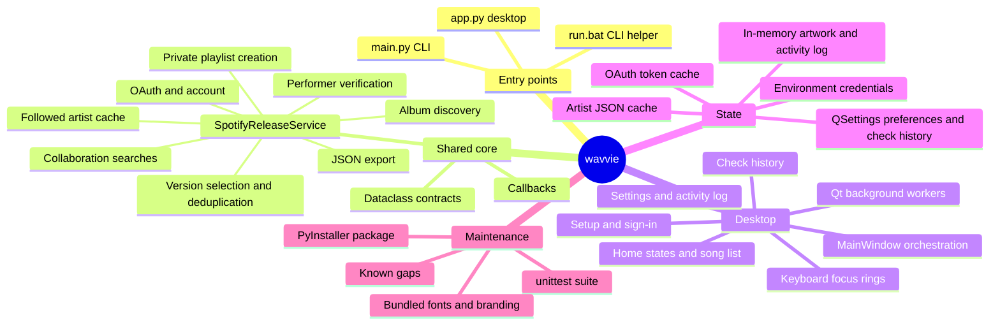
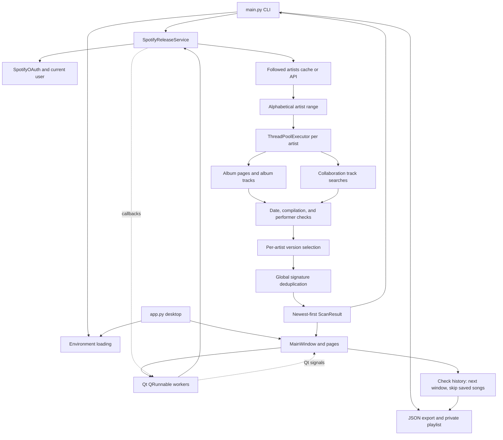

# wavvie repository mind map

Last assessed: 2026-10-10. This is a working map of the implementation, not a proposed redesign. Update it when flows, contracts, persistence, or known issues change. Source code remains authoritative.

## Purpose and current shape

wavvie discovers releases from Spotify artists the user follows, removes unwanted compilations and duplicate tracks, exports JSON, and creates private playlists. It has two entry points sharing one service: a Python CLI and a native PySide6 desktop helper. There is no implemented web frontend, REST server, or database.

## Module ownership

| Location | Responsibility and relationships |
| --- | --- |
| `app.py` | A packaged build first moves into its own folder (`use_app_folder`), so `.env` and caches live beside the executable wherever it was launched from. Then it loads the environment, creates the QApplication, loads fonts and the icon, and opens MainWindow. With `WAVVIE_SMOKE_TEST` set it quits after showing the window, which CI uses to prove a build starts. |
| `main.py` | Environment discovery, argument validation, CLI logging callbacks, authentication, scan, export, playlist creation. Importing it also loads environment and configures logging. |
| `core/spotify_service.py` | Shared business logic and Spotify calls; independent of Qt. Owns authentication, cancellation flag, callback registry, scanning, caches, and outputs. |
| `core/models.py` | `ScanConfiguration` inputs; `ScanProgress` events; `Track`, `ScanResult`, and `PlaylistResult` outputs. `Artist` and `Album` dataclasses exist but the service principally uses raw dictionaries for these entities. |
| `core/workers.py` | QRunnable adapters for authentication, loading artists, scans, playlists, and image downloads. Converts service callbacks into Qt signals. |
| `core/history.py` | Check history, independent of Qt. `CheckRecord` holds start, end, run time, songs, playlist name and link, `complete`, artist range and track IDs. `CheckHistory.next_window()` gives the next start and its kind (first, ready, up_to_date, finish), `saved_ids_since()` the songs to skip, and `add()` keeps 20 records and drops track IDs once no later check can overlap them. Also the dated playlist name, description and short date labels. |
| `ui/main_window.py` | Desktop coordinator. Owns the service, thread pool, header (wordmark, avatar, Settings), stacked pages, the one-operation lock, the check, save and record flow, per-account history in QSettings, the artwork cache, shortcuts, close handling and focus rings. Keeps the header over the content column, including while a scroll bar narrows it. |
| `ui/pages/setup_page.py` | First run without credentials: dashboard link, copyable redirect URI and Client ID/secret validation. Emits the values `main.save_environment` writes to `.env`. |
| `ui/pages/sign_in_page.py` | Connect Spotify, wait for the browser with Cancel, and show a failure with the redirect URI kept on one line. |
| `ui/pages/home_page.py` | One state-driven screen: loading, no artists, the ready variants, checking (wave line and progress), saving, done with the song list, partly saved, nothing new, not saved, stopped and failed. The Change dates row's picker greys out days after today. Earlier checks are one aligned grid. |
| `ui/pages/settings_page.py` | Account and Disconnect, first-check look-back, and advanced options (artist range, parallel checks, JSON copy, reduced motion, refresh artists, activity log). Saves on change; `read_preferences()` is the only reader. |
| `ui/messages.py` | Plain-language Spotify and network errors (`friendly_error`), and `keep_together` so a URL never wraps mid-address. |
| `ui/theme.py`, `ui/widgets/*` | "Low tide" palette and role-based stylesheet; builders for labels, buttons, rules and the centred 600 px column; `WaveLine`, `Avatar`, the `ActivityLog` dialog and `ElidedLabel`. `FocusRings` shows focus indicators only after keyboard use. `Wordmark` draws the logo from `resources/wavvie_wordmark.svg`, a vector trace of the PNG master, so it stays sharp at any display scale; `Tide` paints three calm waves along the foot of every page. |
| `ui/resources.py`, `ui/font_loader.py` | Resolves source versus PyInstaller resource paths and builds the window icon from the `wavvie_mark_*.png` sizes (the `.ico` is only the Windows executable's own icon); loads Loubag/Agrandir fonts directly from bundled ZIPs. |
| `Wavefeed.spec` | Packages `app.py` and the resources the app loads into one windowed file: `dist/wavvie.exe` on Windows, `dist/wavvie` on Linux. A test checks that every resource the code loads is listed. The spec filename retains an older name. |
| `.github/workflows/release.yml`, `.github/scripts/ci.py` | On every push, Windows and Linux (Ubuntu 22.04, for an older glibc) runners run the tests, build the app and launch it once in smoke-test mode. A `v*` tag also publishes `wavvie-windows-x64.exe` and `wavvie-linux-x86_64.tar.gz` as a GitHub release. `ci.py` repeats failures as annotations, which the API serves without signing in (job logs need a token). |
| `tests/fake_spotify.py` | In-memory Spotify Web API transport for tests; models the Development Mode routes listed below and can refuse, silently cap or accept 50-item pages. |

## End-to-end relations

### Discovery rules

1. Authenticate with OAuth scopes `user-follow-read playlist-modify-private`.
2. Load cached followed artists unless refresh is requested. Fresh API data is paginated in groups of 50, sorted case-insensitively by name, and cached.
3. Apply a **1-based inclusive** artist range. End is clamped to the followed-artist count. Defaults are start 1 and end 9999, so “all” is a practical sentinel rather than unlimited.
4. Submit artists to a ThreadPoolExecutor, default 5 workers. Each artist runs album discovery followed by collaboration searches.
5. Album discovery requests the `album`, `single` and `appears_on` groups separately (compilations are rejected anyway), skipping repeated listings of an album ID. It rejects compilation types and a hardcoded list of title substrings. Pages hold 50 releases, or 10 for the rest of the session once Spotify refuses 50 with "Invalid limit". Paging follows Spotify's `next` link and advances by the items returned, so a silently capped page is not mistaken for the last. A group stops when there is no next page, after 200 releases, on a request error, or once a page passes the cutoff while that group's dates have arrived newest first; out-of-order dates make it read on.
6. Cutoff is **inclusive**: release dates before cutoff are rejected. Year-only dates become January 1; year-month dates become the first of that month. There is no upper date bound.
7. Album tracks must explicitly credit the followed artist's Spotify ID. Album artist membership determines main versus featured role. Collaboration means the followed artist is absent from album-level artist credits, not simply that multiple performers exist.
8. Collaboration discovery runs six queries using feat/featuring/ft/with/remix/mix, each limited with a `year:` filter from the cutoff year to the current year, up to 30 results per query (one request, or three when pages are limited to 10). It checks cutoff, compilation rules, performer ID, title substrings, and absence from album-level main artists. This is heuristic discovery, not an exhaustive collaboration catalog.
9. Signature = lowercase track name without bracketed feat./ft./featuring notes (closed or not), plus sorted lowercase performer names, joined by `|`. Featured performers are already in the artist list; the live catalog had one song on two album editions whose titles differed only by a missing closing parenthesis. No other whitespace/version normalization, ISRC matching, or artist-ID-based signature is applied.
10. Within an artist's album results, prefer album, then single, EP, compilation, unknown; tie-break by earliest release-date string. Search results only supplement signatures absent from album results.
11. Across artists, first completed result wins for each signature. Global selection does not reapply album-version priority. Final tracks sort descending by their original release-date strings.
12. The API reports EPs as singles. A single with four or more tracks is labelled `ep`, as Spotify's apps do, for both album and search discoveries.

### Spotify Web API constraints

Checked against Spotify's reference and February 2026 migration guide on 2026-10-10. They apply to Development Mode apps (every app without extended quota; existing apps were migrated on 2026-03-09):

- `GET /search` and `GET /artists/{id}/albums` accept `limit` 1–10. `GET /albums/{id}/tracks` and `GET /me/following` still accept up to 50.
- Playlists are created with `POST /me/playlists`; `POST /users/{id}/playlists` was removed. Items are added with `POST /playlists/{id}/items`, at most 100 per request; spotipy 2.26.0 is the first release using the `/items` routes.
- The app owner needs Spotify Premium, and an app has at most five users.
- The migration guide removes `album_group` from album objects (the artist-albums reference still lists it as deprecated) and `followers`/`popularity` from artist objects. wavvie relies on none of them.

A live check on 2026-10-10 with a Development Mode app found the documentation stricter than the service. Spotify still served 50 search results and artist albums per page, and album objects still carried `album_group`. Albums and singles came back newest first (15 of 15 groups checked); appears-on releases did not (6 of 6). wavvie therefore asks for 50 and falls back to 10 only if refused. Recheck Spotify's changelog for anything newer.

### Desktop orchestration

- Startup checks credentials. Without them, Setup collects the Client ID and secret, writes `.env` with `save_environment` and rechecks. An existing `.spotifycache` triggers authentication; otherwise Sign-in waits for **Connect Spotify**.
- Without a valid cached token, spotipy opens the browser and waits, with no timeout, for one request to the local redirect URI. **Cancel** and window close release that wait by sending the callback server an `error=cancelled` redirect, which spotipy treats as a refused sign-in; close repeats it until the auth worker finishes.
- Successful sign-in loads the account's history from `check_history/<user id>`, loads followed artists in the background and shows Home.
- Home's one button checks from `next_window()`'s start to today. The first check looks back the chosen number of days, later checks start on the day the last one ended, and an incomplete last check is covered again. **Change dates** sets a different start for one check. The Advanced artist range and parallel-check count apply.
- After the scan, songs saved by earlier checks in that window are dropped. If none remain, the check is recorded without a playlist. Otherwise the optional JSON copy is written and a private playlist named "wavvie · New releases {start} – {end}" is created straight away; the check is recorded with the song IDs Spotify confirmed. Failed artists, an artist range or a partly saved playlist mark it incomplete.
- When Spotify doesn't create the playlist, the found songs stay pending, so **Try saving again** doesn't rescan.
- The window-owned Qt pool has a maximum of 10 threads for jobs/images. A scan job creates its own Python artist pool. Service callbacks bridge to signals; widgets should receive updates through these signals.
- Callback registry allows **one callback per event**. Worker adapters temporarily bind and restore callbacks. MainWindow serializes service operations; image jobs may run concurrently.
- Cancellation is cooperative. API attempts and scanning loops check a flag that callers clear before starting (MainWindow does so in `start_check`), so a Stop pressed before the scan reaches its first check still counts. Running requests, some sleeps, and executor cleanup can delay completion. Cancelled scans return no ScanResult, and warnings raised after cancellation is requested are dropped.

### Outputs and side effects

- CLI attempts JSON export and playlist creation after a successful scan that found tracks; its arguments do not expose opt-out flags. A scan without new releases skips both. The desktop saves every check's new songs to a new playlist, writing the JSON copy first only when the Advanced setting is on.
- JSON is written into the current working directory as `tracklist_START_END_TIMESTAMP.json`, with metadata and a simplified track list. It includes `has_artwork` but omits the artwork URL, album ID, and followed-artist ID; it is not a complete serialized Track object.
- Playlist creation creates a new private playlist with `POST /me/playlists` and adds track IDs in batches of 100. The name gets an "(Artists X-Y)" suffix only when the scan did not cover every followed artist; scan results record the followed-artist count for this. The desktop passes a dated name and the description "New releases from artists you follow, {start} – {end} {year}. Made with wavvie."; the service adds " - Range: x-y" to a description only for a partial scan. There is no rollback on partial failure; the desktop's check record lets the next check finish the window.
- API wrapper defaults: 3 attempts, 1.2 seconds after successful calls, Retry-After waits for 429, exponential waits for server/other errors. Retries are only logged; a call that fails every attempt reaches the caller, which reports a warning. Throttling is per call/thread, not a global request budget. Some auth calls bypass this wrapper.

## State and configuration

| State | Storage / lifecycle |
| --- | --- |
| Client ID, secret, redirect URI | Environment and `.env`; example keys in `.env.example`. Loader searches working directory, source directory, executable directory, executable parent; existing environment wins (`override=False`). |
| OAuth tokens | `.spotifycache`, relative to working directory; disconnect deletes it. |
| Followed artists | `followed_artists_cache.json`, relative to working directory; stores account ID and artist list. Explicit refresh, account changes, and legacy format trigger a fetch; disconnect clears it. No expiry. |
| Desktop preferences | QSettings organization `wavvie`, application `SpotifyPlaylistCreator`: `default_cutoff_days` (first-check look-back: 7, 30, 90 or 180), `artist_range_enabled`, `artist_range_start`, `artist_range_end`, `default_workers`, `auto_export_json` and `reduced_motion`. Platform-native storage, normally the Windows registry here. |
| Check history | `check_history/<user id>` in the same namespace: JSON list of the newest 20 checks (dates, run time, song count, playlist name and link, `complete`, artist range, and track IDs while a later check may still overlap them). Disconnect keeps it, so signing back in restores it. |
| Working data | Service account/client state, the pending save, activity log lines (newest 2,000) and the URL-keyed artwork cache (256 images) live in memory. |
| Build/runtime dependencies | `spotipy>=2.26.0` (the `/items` playlist routes); unpinned `requests`, `python-dotenv`, `PySide6`, `pillow`, `pyinstaller` in requirements.txt; runtime and build dependencies share one file. |

Credentials, caches, exports, virtual environments, and build outputs are gitignored. Never add credential/token values to this map. CI is described in the module table.

## UX improvements and remaining verification

The UI/UX pass on 2026-09-06 resolved the original duplicate-count, artwork import/lifecycle, redirect URI, credential recheck, custom playlist metadata, partial playlist count, reduced motion, scan-origin, and range-validation findings. The helper rework on 2026-10-10 replaced the dashboard (sidebar, scan form, Results and Activity pages) with one window built around check history; see `docs/superpowers/specs/2026-10-10-helper-ui-design.md`.

### Current interaction contracts

- One account, artist, scan or playlist operation at a time. `operation` is `None`, `auth`, `artists`, `scan`, `cancelling`, or `playlist`; `closing` prevents further work. Settings disables Disconnect and Refresh artist list while one runs. Closing waits asynchronously for active workers, avoiding widget destruction while signals are in flight.
- `ScanWorker`, `AuthWorker`, and other service adapters detach their callbacks before emitting exactly one terminal signal. MainWindow retains jobs until queued completion reaches the UI thread. There are no persistent callbacks pointing at finished Qt workers.
- Home shows exactly the actions in the spec's state table, and a test clicks every visible button in every state and checks its effect. Earlier checks (the last five) appear only while waiting to check, in one grid so counts line up, with hairlines between rows.
- The song list opens a track on click or Enter, elides long titles and artists with full tooltips, separates rows with hairlines, and requests artwork only for rows within 200 px of the viewport.
- Coral notes explain partial outcomes. The check record's `complete` flag decides whether the next check finishes the window.
- Settings loading blocks signals, so loading one control can't overwrite the others. Changes save at once, with visible feedback if they can't be written. The artist range covers every followed artist until a range is saved, and its fields dim while the checkbox is off.
- Keyboard: Tab stops only on controls (scroll areas take click focus only). Focus indicators appear after keyboard use and clear on the next click: `FocusRings` sets a `focusRing` property that the stylesheet styles, because Qt moves focus by itself when the focused widget hides. Text fields always show focus. Ctrl+, opens Settings, Esc closes it and Ctrl+L opens the activity log.
- Layout: one centred column up to 600 px wide, and the header follows it, including while a scroll bar narrows the page. Windows from 720×560 never scroll sideways. Short Home, Sign-in and Setup screens rest just above the middle (spare height splits 2:3); Settings stays top-aligned so opening the advanced options doesn't move it. A low tide fills the foot of every page, and content always ends above it. The logo, account picture and artwork are drawn at the display's resolution, so a 200% screen gets sharp pixels. Quiet buttons have no side padding, so their text lines up with the column, and keyboard focus underlines them.
- Reduced motion keeps the wave line still; its timer runs only while it is visible and checking.
- Credential recheck refreshes only environment values owned by the dotenv loader; explicit process variables keep precedence.
- Artist caches contain `user_id` and `artists`. Legacy/account-mismatched caches refresh automatically, and failed fetches do not replace an existing cache. Disconnect clears cached artists.

### Remaining scope boundaries

- Discovery heuristics (queries, title keywords, first-completed global selection) are unchanged apart from paging and feature-note handling in signatures. The live check covered the CLI path; the 10-item fallback has only run against the fake, and the helper window has not been run against Spotify.
- The activity log is session-only. A created or partly filled playlist has no rollback; its link stays in the check history, and the next check covers the window again.
- Token, artist-cache, `.env` (written by Setup) and JSON-copy files are relative to the working directory. Packaged builds move into their own folder first, so they need a folder the user can write to; a read-only install location means Setup can't save and the sign-in isn't remembered.

## Validation baseline

The original assessment ran 19 tests with two QSettings failures in the sandbox. Tests now isolate preferences in temporary INI files, and the original 19 tests pass. `tests/test_desktop_ux.py` drives the real window against the fake Spotify transport: first and follow-up checks, skipped songs, partial and failed saves, stopping, changed dates, JSON copies, artist ranges, settings, accounts, disconnect, setup, sign-in cancellation, shutdown, worker signal delivery and cleanup. Page tests cover each screen's states, and `tests/test_history.py` covers the window rules.

Automated layout checks render every page at 720×560, 900×680 and 1600×1000 with bundled fonts and long names and fail on sideways scrolling; others check that the header lines up with the column and that Tab only stops on controls. The suite captures unhandled Qt slot errors rather than treating a printed traceback as a pass. Tests make no live Spotify requests and do not inspect screenshots.

Validation on 2026-09-06: 50 tests passed, plus the layout test at 150% display scaling. The image-completion test in that suite was flaky: it asserted worker cleanup before the separately queued cleanup slot had run, failing in about a third of runs on 2026-10-10.

`tests/test_spotify_web_api.py` runs the real spotipy client against `tests/fake_spotify.py`, covering refused, silently capped and accepted 50-item pages. `tests/test_cli.py` covers CLI orchestration with a stand-in service. Sign-in tests start spotipy's real local redirect server with the browser launch patched out.

Final validation on 2026-10-10, after adding release builds: **131 tests passed** in three consecutive full runs, and a local PyInstaller build of `wavvie.exe` started and quit cleanly in smoke-test mode. Linux is verified by the CI runners. After the helper rework: 126 tests passed in three consecutive full runs, plus the layout test at **150% display scaling**. Every state was rendered offscreen at 900×680 and 720×560 and reviewed by eye, and keyboard focus was checked by tabbing through Home and Settings on the native Windows platform (windows11 style).

Live check on 2026-10-10 (Development Mode app, CLI): sign-in, 325 followed artists, and a five-artist scan of artists 1–5 since 2026-09-10 (5 tracks in 22 seconds, previously 55 seconds with fixed 10-item pages). Also covered: JSON export, and one private playlist created with `POST /me/playlists`. Its 5 items were added with `/items` and read back unique and in export order. That run also found the feature-note duplicate and the missing `main_artist` on album-found features, both since fixed. The image-completion test now waits for both the UI-thread callback and worker release (30 of 30 isolated runs passed). Use `python -m unittest discover -s tests -v`; the desktop regression module selects Qt's offscreen platform. On Windows, run in an environment that permits temporary-file creation and cleanup. `git diff --check` should also pass.

## Where to work next

- Discovery/filtering/deduplication changes: service methods plus focused tests in `tests/test_spotify_release_tool.py` and `tests/test_spotify_web_api.py`.
- Check flow: HomePage signals → MainWindow (`start_check`, `on_check_finished`, `save_pending`, `record_check`) → `core/history.py`, with tests in `tests/test_desktop_ux.py` and `tests/test_history.py`.
- Screen states and copy: `ui/pages/*`, with `tests/test_home_page.py`, `tests/test_pages.py` and `tests/test_settings_page.py`. The every-button test lists each state's buttons.
- Configuration changes: `.env` loader + `save_environment` + SetupPage, or SettingsPage + `read_preferences` + `MainWindow.apply_preferences`.
- Styling/packaging changes: `ui/theme.py` (role selectors and `[focusRing]`), `ui/widgets/controls.py`, resource helpers and Wavefeed.spec, which bundles `wavvie_wordmark.svg` for the logo. Existing tests assert Loubag/Agrandir fonts and nonnegative explicit letter spacing.
- README images: `docs/media/make_media.py` renders the banner, GIFs and screenshots from the app, offscreen and with made-up demo data. Rerun it after visible UI changes.

Keep this map current by recording behavior changes, affected relationships, new state/files, resolved findings, and the latest validation result. Do not treat an unchecked hypothesis as a confirmed defect or a design prompt as implemented code.
