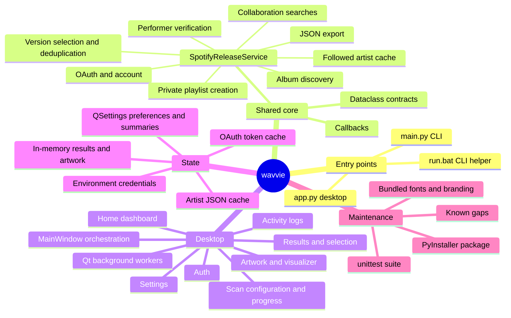
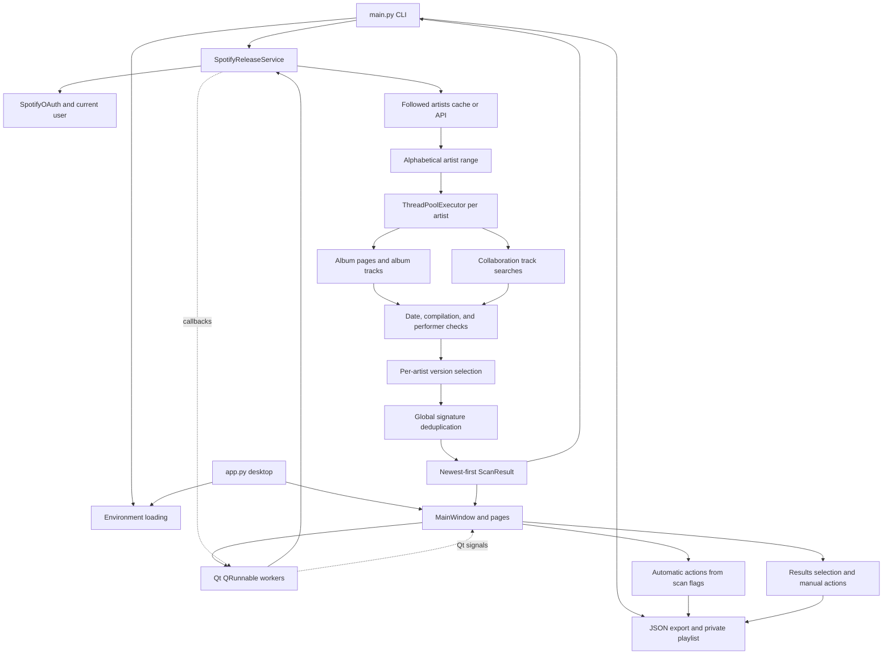

# wavvie repository mind map

Last assessed: 2026-10-10. This is a working map of the implementation, not a proposed redesign. Update it when flows, contracts, persistence, or known issues change. Source code remains authoritative.

## Purpose and current shape

wavvie discovers releases from Spotify artists the user follows, removes unwanted compilations and duplicate tracks, exports JSON, and creates private playlists. It has two entry points sharing one service: a Python CLI and a native PySide6 desktop dashboard. There is no implemented web frontend, REST server, or database.

## Module ownership

| Location | Responsibility and relationships |
| --- | --- |
| `app.py` | Loads environment, creates QApplication, loads fonts/icon, opens MainWindow. |
| `main.py` | Environment discovery, argument validation, CLI logging callbacks, authentication, scan, export, playlist creation. Importing it also loads environment and configures logging. |
| `core/spotify_service.py` | Shared business logic and Spotify calls; independent of Qt. Owns authentication, cancellation flag, callback registry, scanning, caches, and outputs. |
| `core/models.py` | `ScanConfiguration` inputs; `ScanProgress` events; `Track`, `ScanResult`, and `PlaylistResult` outputs. `Artist` and `Album` dataclasses exist but the service principally uses raw dictionaries for these entities. |
| `core/workers.py` | QRunnable adapters for authentication, loading artists, scans, playlists, and image downloads. Converts service callbacks into Qt signals. |
| `ui/main_window.py` | Desktop coordinator. Owns service, thread pool, pages, active configuration, image cache, signal connections, and automatic post-scan actions. |
| `ui/pages/auth_page.py` | Environment/setup instructions and connect/recheck UI. |
| `ui/pages/dashboard_page.py` | Saved summary, quick scan, current scan state, logs, and release pulses. |
| `ui/pages/scan_page.py` | Builds ScanConfiguration from controls; displays progress and cancellation UI. |
| `ui/pages/results_page.py` | Track rows, text/type/role filters, checkboxes, details, Spotify links, manual export/playlist signals. |
| `ui/pages/activity_page.py` | Bridges Python logging to a filterable, copyable, in-memory activity log. |
| `ui/pages/settings_page.py` | Persists preferences; emits disconnect/cache-clear/settings-change requests. |
| `ui/theme.py`, `ui/widgets/*` | Shared styling, sidebar, elided labels, animated visualizer. |
| `ui/resources.py`, `ui/font_loader.py` | Resolves source versus PyInstaller resource paths; loads Loubag/Agrandir fonts directly from bundled ZIPs. |
| `Wavefeed.spec` | Packages `app.py` and explicit font/branding assets into windowed `dist/wavvie.exe`; spec filename retains an older name. |
| `tests/fake_spotify.py` | In-memory Spotify Web API transport for tests; models the Development Mode routes listed below and can refuse, silently cap or accept 50-item pages. |

## End-to-end relations

### Discovery rules

1. Authenticate with OAuth scopes `user-follow-read playlist-modify-private`.
2. Load cached followed artists unless refresh is requested. Fresh API data is paginated in groups of 50, sorted case-insensitively by name, and cached.
3. Apply a **1-based inclusive** artist range. End is clamped to the followed-artist count. Defaults are start 1 and end 9999, so “all” is a practical sentinel rather than unlimited.
4. Submit artists to a ThreadPoolExecutor, default 5 workers. Each artist runs album discovery followed by collaboration searches.
5. Album discovery requests the `album`, `single` and `appears_on` groups separately (compilations are rejected anyway), skipping repeated listings of an album ID. It rejects compilation types and a hardcoded list of title substrings. Pages hold 50 releases, or 10 for the rest of the session once Spotify refuses 50 with "Invalid limit". Paging follows Spotify's `next` link and advances by the items returned, so a silently capped page is not mistaken for the last. A group stops when there is no next page, after 200 releases, on a request error, or once a page passes the cutoff while that group's dates have arrived newest first; out-of-order dates make it read on.
6. Cutoff is **inclusive**: release dates before cutoff are rejected. Year-only dates become January 1; year-month dates become the first of that month. There is no upper date bound.
7. Album tracks must explicitly credit the followed artist's Spotify ID. Album artist membership determines main versus featured role. Collaboration means the followed artist is absent from album-level artist credits, not simply that multiple performers exist.
8. Collaboration discovery runs six queries using feat/featuring/ft/with/remix/mix, each limited with a `year:` filter from the cutoff year to the current year, up to 30 results per query (one request, or three when pages are limited to 10). It checks cutoff, compilation rules, performer ID, title substrings, and absence from album-level main artists. This is heuristic discovery, not an exhaustive collaboration catalog.
9. Signature = lowercase track name without bracketed feat./ft./featuring notes (closed or not), plus sorted lowercase performer names, joined by `|`. Featured performers are already in the artist list; the live catalog had one song on two album editions whose titles differed only by a missing closing parenthesis. No other whitespace/version normalization, ISRC matching, or artist-ID-based signature is applied.
10. Within an artist's album results, prefer album, then single, EP, compilation, unknown; tie-break by earliest release-date string. Search results only supplement signatures absent from album results.
11. Across artists, first completed result wins for each signature. Global selection does not reapply album-version priority. Final tracks sort descending by their original release-date strings.
12. The API reports EPs as singles. A single with four or more tracks is labelled `ep`, as Spotify's apps do, for both album and search discoveries.

### Spotify Web API constraints

Checked against Spotify's reference and February 2026 migration guide on 2026-10-10. They apply to Development Mode apps (every app without extended quota; existing apps were migrated on 2026-03-09):

- `GET /search` and `GET /artists/{id}/albums` accept `limit` 1–10. `GET /albums/{id}/tracks` and `GET /me/following` still accept up to 50.
- Playlists are created with `POST /me/playlists`; `POST /users/{id}/playlists` was removed. Items are added with `POST /playlists/{id}/items`, at most 100 per request; spotipy 2.26.0 is the first release using the `/items` routes.
- The app owner needs Spotify Premium, and an app has at most five users.
- The migration guide removes `album_group` from album objects (the artist-albums reference still lists it as deprecated) and `followers`/`popularity` from artist objects. wavvie relies on none of them.

A live check on 2026-10-10 with a Development Mode app found the documentation stricter than the service. Spotify still served 50 search results and artist albums per page, and album objects still carried `album_group`. Albums and singles came back newest first (15 of 15 groups checked); appears-on releases did not (6 of 6). wavvie therefore asks for 50 and falls back to 10 only if refused. Recheck Spotify's changelog for anything newer.

### Desktop orchestration

- Startup checks credentials; an existing `.spotifycache` triggers authentication. Successful auth loads followed artists in the background and opens Home.
- Without a valid cached token, spotipy opens the browser and waits, with no timeout, for one request to the local redirect URI. **Cancel sign-in** and window close release that wait by sending the callback server an `error=cancelled` redirect, which spotipy treats as a refused sign-in; close repeats it until the auth worker finishes.
- Quick Start applies saved preferences to the scan form and starts from Home. Custom Scan gathers the form values. Both use the same service and update Home plus Scan progress.
- Successful scans populate Results, persist summary/range, and run automatic export/playlist actions according to active scan flags. Home-origin scans stay on Home; other scans navigate to Results.
- Manual Results actions gather checked, visible list items. Hidden rows are excluded, and selection counts report the same subset.
- The window-owned Qt pool has a maximum of 10 threads for jobs/images. A scan job creates its own Python artist pool. Service callbacks bridge to signals; widgets should receive updates through these signals.
- Callback registry allows **one callback per event**. Worker adapters temporarily bind and restore callbacks. MainWindow serializes service operations; image jobs may run concurrently.
- Cancellation is cooperative. API attempts and scanning loops check a flag; running requests, some sleeps, and executor cleanup can delay completion. Cancelled scans return no ScanResult, and warnings raised after cancellation is requested are dropped.

### Outputs and side effects

- CLI attempts JSON export and playlist creation after a successful scan that found tracks; its arguments do not expose opt-out flags. A scan without new releases skips both. Desktop controls the automatic actions and also offers manual ones.
- JSON is written into the current working directory as `tracklist_START_END_TIMESTAMP.json`, with metadata and a simplified track list. It includes `has_artwork` but omits the artwork URL, album ID, and followed-artist ID; it is not a complete serialized Track object.
- Playlist creation creates a new private playlist with `POST /me/playlists` and adds track IDs in batches of 100. The name gets an "(Artists X-Y)" suffix only when the scan did not cover every followed artist; scan results record the followed-artist count for this. There is no rollback or resume record on partial failure.
- API wrapper defaults: 3 attempts, 1.2 seconds after successful calls, Retry-After waits for 429, exponential waits for server/other errors. Throttling is per call/thread, not a global request budget. Some auth calls bypass this wrapper.

## State and configuration

| State | Storage / lifecycle |
| --- | --- |
| Client ID, secret, redirect URI | Environment and `.env`; example keys in `.env.example`. Loader searches working directory, source directory, executable directory, executable parent; existing environment wins (`override=False`). |
| OAuth tokens | `.spotifycache`, relative to working directory; disconnect deletes it. |
| Followed artists | `followed_artists_cache.json`, relative to working directory; stores account ID and artist list. Explicit refresh, account changes, and legacy format trigger a fetch; disconnect clears it. No expiry. |
| Desktop preferences | QSettings organization `wavvie`, application `SpotifyPlaylistCreator`; workers, playlist name/description, auto actions, cutoff days/index, reduced motion. Platform-native storage, normally Windows registry here. |
| Saved summaries | Same QSettings namespace: last scan date/count/range and followed-artist count. Full scan results/history are not persisted there. |
| Working data | Service account/client state, active config, results rows, activity logs, and URL-keyed image caches live in memory. |
| Build/runtime dependencies | `spotipy>=2.26.0` (the `/items` playlist routes); unpinned `requests`, `python-dotenv`, `PySide6`, `pillow`, `pyinstaller` in requirements.txt; runtime and build dependencies share one file. |

Credentials, caches, exports, virtual environments, and build outputs are gitignored. Never add credential/token values to this map. No tracked CI workflow was found during this assessment.

## UX improvements and remaining verification

The UI/UX pass on 2026-09-06 resolved the original duplicate-count, artwork import/lifecycle, redirect URI, credential recheck, custom playlist metadata, partial playlist count, reduced motion, scan-origin, and range-validation findings.

### Current interaction contracts

- One active account/scan/playlist operation at a time. Navigation remains available. Start, disconnect, refresh, and result mutation actions stay disabled until the active job finishes, including cancellation cleanup.
- `operation` is `None`, `auth`, `artists`, `scan`, `cancelling`, or `playlist`; `closing` prevents further work. Closing waits asynchronously for active workers, avoiding widget destruction while signals are in flight.
- `ScanWorker`, `AuthWorker`, and other service adapters detach their callbacks before emitting exactly one terminal signal. MainWindow retains jobs until queued completion reaches the UI thread. There are no persistent callbacks pointing at finished Qt workers.
- Quick Scan covers all followed artists, displays the cutoff/output defaults on Home, and keeps Home visible. Custom scans return to Results. Completion resets the Scan form; warnings remain visible and suppress automatic playlist creation.
- Results use list-item visibility as the source of truth for selection, counts, select-all, and manual outputs. Hidden tracks retain their checkboxes but are excluded from actions. Empty scans and empty filters have distinct messages.
- Results are prepared in batches of 50 with a Qt timer; export and playlist actions wait until all rows are ready. A newer result set cancels pending batches for the old set.
- Manual JSON export offers a save dialog. Automatic export uses the existing working-directory convention. Export folder and playlist links remain available together after both actions complete.
- Playlist metadata/ranges belong to the displayed completed result, so a later failed scan cannot relabel older results. Partial playlist results include a URL, confirmed track count, and error message. Uncertain write requests are not automatically retried; the HTTP session also disables implicit transport retries.
- Notifications persist in the main window until dismissed. Sidebar status is visible. Details display catalog strings as plain text; long row titles have ellipses and full tooltips.
- Scrollable forms and adaptive results details support windows from 1000×640. Focus borders, input names/label buddies, searchable lists, and selectable setup text improve keyboard and assistive access. Loubag/Agrandir branding is retained.
- Reduced motion stops visualizer animation and tip rotation. Hidden visualizers stop their timers. Activity is batched and capped at 2,000 entries; scan logs and artwork caches are bounded. Results request artwork only for visible rows and the selected detail, with a small scroll margin.
- Settings loading blocks signals, preventing partial form initialization from overwriting saved preferences. Text preferences save after editing, with visible saved/error feedback. Credential recheck refreshes only environment values owned by the dotenv loader; explicit process variables keep precedence.
- Artist caches now contain `user_id` and `artists`. Legacy/account-mismatched caches refresh automatically, and failed fetches do not replace an existing cache. Disconnect clears cached artists and in-memory results.

### Remaining scope boundaries

- Discovery heuristics (queries, title keywords, first-completed global selection) are unchanged apart from paging and feature-note handling in signatures. The live check covered the CLI path; the 10-item fallback has only run against the fake, and the desktop window has not been run against Spotify.
- The 1,000-track results test can exceed its 8-second limit on a busy machine. Profiling showed row-widget construction dominates (about 0.9 s of 2.2 s in Python, the rest in Qt), not filtering; a faster list would need a model/view rewrite.
- Full results and activity history remain session-only. A created or partially populated playlist has no rollback/resume mechanism; its link is retained for inspection.
- Token, artist-cache and automatic-export files are relative to the working directory, so a packaged app started with an unexpected working directory writes them there.

## Validation baseline

The original assessment ran 19 tests with two QSettings failures in the sandbox. Tests now isolate preferences in temporary INI files, and the original 19 tests pass. `tests/test_desktop_ux.py` adds real-widget, mocked-service regression coverage for selection, empty states, validation, settings initialization, reduced motion, cancellation, shutdown, worker signal delivery/cleanup, output actions, partial playlists, cache/account behavior, and environment refresh.

Automated layout checks exercise every page at 1000×640, 1280×820, and 1600×1000 with bundled fonts, plus long track names. The suite captures unhandled Qt slot errors rather than treating a printed traceback as a pass. Tests make no live Spotify requests and do not inspect screenshots manually.

Validation on 2026-09-06: 50 tests passed, plus the layout test at 150% display scaling. The image-completion test in that suite was flaky: it asserted worker cleanup before the separately queued cleanup slot had run, failing in about a third of runs on 2026-10-10.

`tests/test_spotify_web_api.py` runs the real spotipy client against `tests/fake_spotify.py`, covering refused, silently capped and accepted 50-item pages. `tests/test_cli.py` covers CLI orchestration with a stand-in service. Sign-in tests start spotipy's real local redirect server with the browser launch patched out.

Final validation on 2026-10-10: **77 tests passed** in three consecutive full runs, plus the layout test at **150% display scaling**. A 1,000-track result set showed its initial 50-row batch in 0.18–0.46 seconds and finished in 3.6–7.6 seconds with event-loop yields; on a busy machine that test can exceed its 1 s and 8 s limits.

Live check on 2026-10-10 (Development Mode app, CLI): sign-in, 325 followed artists, and a five-artist scan of artists 1–5 since 2026-09-10 (5 tracks in 22 seconds, previously 55 seconds with fixed 10-item pages). Also covered: JSON export, and one private playlist created with `POST /me/playlists`. Its 5 items were added with `/items` and read back unique and in export order. That run also found the feature-note duplicate and the missing `main_artist` on album-found features, both since fixed. The image-completion test now waits for both the UI-thread callback and worker release (30 of 30 isolated runs passed). Use `python -m unittest discover -s tests -v`; the desktop regression module selects Qt's offscreen platform. On Windows, run in an environment that permits temporary-file creation and cleanup. `git diff --check` should also pass.

## Where to work next

- Discovery/filtering/deduplication changes: service methods plus focused tests in `tests/test_spotify_release_tool.py`.
- Scan lifecycle/progress changes: service callbacks → workers → MainWindow → Home/Scan pages.
- Output/selection changes: ResultsPage → MainWindow → export or PlaylistWorker → service.
- Configuration changes: `.env` loader + service constructor + AuthPage, or SettingsPage + MainWindow.apply_preferences + ScanPage.
- Styling/packaging changes: Theme/widgets/pages, resource helpers, and Wavefeed.spec. Existing tests assert Loubag/Agrandir fonts and nonnegative explicit letter spacing.

Keep this map current by recording behavior changes, affected relationships, new state/files, resolved findings, and the latest validation result. Do not treat an unchecked hypothesis as a confirmed defect or a design prompt as implemented code.
